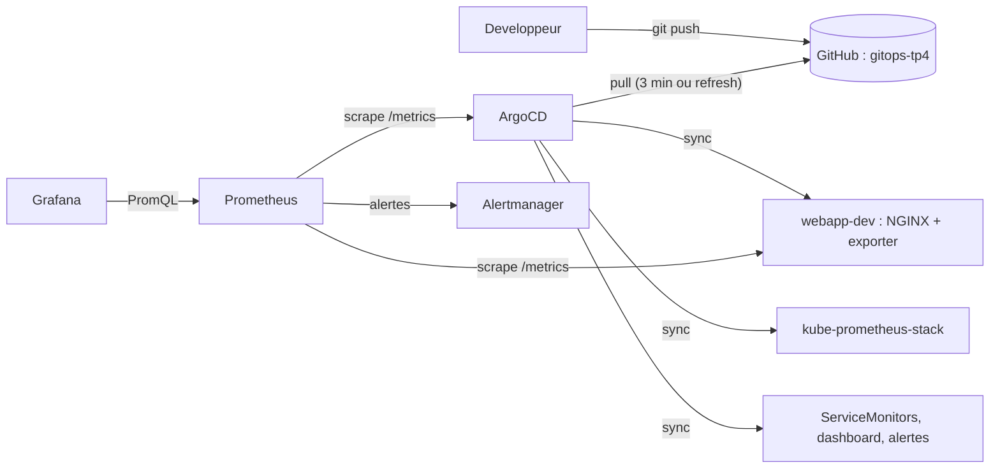

# TP4 : GitOps, ArgoCD et Observabilite pour le Continuous Deployment

Matiere : DevOps, annee 2026/2027, INSAT.
Groupe : Souidi Ons, Bayoudh Roua, Gtari Ghaith, Belgaied Oumaima.

Ce depot est la **source unique de verite** (Single Source of Truth) d'un cluster Kubernetes local (kind) :
l'application, ses manifestes, les applications ArgoCD, la pile d'observabilite (Prometheus, Grafana, Alertmanager),
les ServiceMonitors, le dashboard Grafana et les regles d'alerte sont tous decrits de maniere declarative et
deployes par ArgoCD (pattern **App-of-Apps**).

## 1. Architecture



Principe : aucun `kubectl apply` manuel apres l'amorcage. Le seul objet applique a la main est l'application racine
`root`, qui surveille le dossier `argocd/apps/` et cree une application ArgoCD par fichier.

| Application ArgoCD | Source dans Git | Role |
|---|---|---|
| `root` | `argocd/apps/` | App-of-Apps : cree toutes les autres applications |
| `webapp-dev` | `apps/webapp/overlays/dev` | NGINX + sidecar exporter + ServiceMonitor |
| `kube-prometheus-stack` | chart Helm 93.11.0 (prometheus-community) | Prometheus, Grafana, Alertmanager, kube-state-metrics |
| `argocd-monitoring` | `monitoring/argocd-servicemonitors` | Scraping du control plane ArgoCD |
| `grafana-dashboards` | `monitoring/dashboards` | Dashboard Grafana provisionne (ConfigMap) |
| `monitoring-alerts` | `monitoring/alerts` | Regles d'alerte (PrometheusRule) |

## 2. Structure du depot

```
gitops-tp4/
|-- README.md
|-- cluster/
|   `-- kind-config.yaml            # cluster kind : 1 control-plane + 2 workers
|-- apps/webapp/
|   |-- base/                       # deployment, service, configmap nginx, servicemonitor
|   `-- overlays/
|       |-- dev/                    # namespace webapp-dev, 4 replicas
|       `-- prod/                   # namespace webapp-prod, 3 replicas
|-- argocd/
|   |-- root-app.yaml               # seule application appliquee a la main
|   `-- apps/                       # une Application ArgoCD par fichier
|-- monitoring/
|   |-- argocd-servicemonitors/     # 3 ServiceMonitors (controller, server, repo-server)
|   |-- dashboards/                 # export JSON du dashboard + kustomization (ConfigMap)
|   `-- alerts/                     # PrometheusRule
`-- figures/                        # captures d'ecran du rapport
```

## 3. Amorcage du cluster

Prerequis : Docker, kind, kubectl, Helm, Git.

```bash
kind create cluster --name gitops --config cluster/kind-config.yaml

kubectl create namespace argocd
kubectl apply -n argocd --server-side --force-conflicts \
  -f https://raw.githubusercontent.com/argoproj/argo-cd/stable/manifests/install.yaml

# Seule commande de deploiement manuelle : le reste est tire depuis Git
kubectl apply -f argocd/root-app.yaml
```

Acces aux interfaces (un terminal par port-forward) :

```bash
kubectl port-forward svc/argocd-server -n argocd 8080:443                          # https://localhost:8080
kubectl port-forward svc/kube-prometheus-stack-grafana -n monitoring 3000:80       # http://localhost:3000
kubectl port-forward svc/kube-prometheus-stack-prometheus -n monitoring 9090:9090  # http://localhost:9090
kubectl port-forward svc/kube-prometheus-stack-alertmanager -n monitoring 9093:9093
```

Mots de passe initiaux (utilisateur `admin`) :

```bash
# ArgoCD
kubectl -n argocd get secret argocd-initial-admin-secret -o jsonpath="{.data.password}" | base64 -d
# Grafana
kubectl -n monitoring get secret kube-prometheus-stack-grafana -o jsonpath="{.data.admin-password}" | base64 -d
```

## 4. Choix techniques

- **Kustomize (base + overlays)** plutot que des YAML bruts : une base commune, des overlays par environnement
  (namespace, nombre de repliques, tag d'image). Le tag d'image est surcharge par le champ `images` de l'overlay,
  ce qui rend un changement de version lisible dans un seul fichier.
- **Pull-based (GitOps)** : ArgoCD interroge Git et applique dans le cluster. Aucun acces externe n'est necessaire
  vers l'API Kubernetes.
- **Automated sync + selfHeal + prune** : toute derive manuelle est annulee, toute ressource supprimee de Git est
  supprimee du cluster.
- **App-of-Apps** : l'ensemble de l'infrastructure, observabilite comprise, est pilote par Git.
- **Chart kube-prometheus-stack, version epinglee (93.11.0)** : jamais de `latest` en GitOps, pour garder un
  deploiement reproductible. Options importantes :
  - `ServerSideApply=true` : les CRDs Prometheus sont trop volumineuses pour l'annotation `last-applied`.
  - `serviceMonitorSelectorNilUsesHelmValues: false` (et PodMonitor, regles) : Prometheus decouvre tous les
    ServiceMonitors du cluster, pas uniquement ceux portant le label du chart.
  - composants `kubeEtcd`, `kubeScheduler`, `kubeControllerManager`, `kubeProxy` desactives : non accessibles
    sur kind, ils declencheraient de fausses alertes.
  - sondes Grafana assouplies (timeout 5 s, delais initiaux plus longs) : Grafana demarre lentement sur un
    poste de developpement et etait tue par la liveness probe par defaut (timeout 1 s).
- **Metriques applicatives** : NGINX ne fournit pas de metriques Prometheus natives. Un sidecar
  `nginx-prometheus-exporter` lit `stub_status`, expose sur un port interne (8081) restreint a `127.0.0.1`,
  puis publie les metriques sur le port 9113.
- **Dashboard et alertes dans Git** : le dashboard est un ConfigMap portant le label `grafana_dashboard: "1"`
  (charge par le sidecar de Grafana) et les alertes une `PrometheusRule`. Un `kind delete cluster` ne perd rien.

## 5. Observabilite

### 5.1 Sources de metriques

| Cible | ServiceMonitor | Port | Metriques cles |
|---|---|---|---|
| ArgoCD application-controller | `argocd-metrics` | 8082 | `argocd_app_info`, `argocd_app_sync_total` |
| ArgoCD server | `argocd-server-metrics` | 8083 | API et sessions |
| ArgoCD repo-server | `argocd-repo-server-metrics` | 8084 | `argocd_git_request_total` |
| webapp (sidecar exporter) | `webapp` | 9113 | `nginx_up`, `nginx_http_requests_total`, `nginx_connections_active` |
| Cluster | inclus dans le chart | - | kube-state-metrics, cAdvisor (CPU, memoire) |

### 5.2 Requetes PromQL du dashboard

| Panneau | Requete PromQL |
|---|---|
| Apps Synced | `count(argocd_app_info{sync_status="Synced"}) or vector(0)` |
| Apps OutOfSync | `count(argocd_app_info{sync_status="OutOfSync"}) or vector(0)` |
| Apps Healthy | `count(argocd_app_info{health_status="Healthy"}) or vector(0)` |
| Apps Degraded | `count(argocd_app_info{health_status="Degraded"}) or vector(0)` |
| Tableau Sync / Health | `argocd_app_info` (format table, instantane) |
| Synchronisations (5 min) | `sum by (name) (increase(argocd_app_sync_total[5m]))` |
| Appels Git | `sum by (request_type) (rate(argocd_git_request_total[5m]))` |
| Pods desires | `kube_deployment_spec_replicas{namespace="webapp-dev",deployment="webapp"}` |
| Pods disponibles | `kube_deployment_status_replicas_available{namespace="webapp-dev",deployment="webapp"}` |
| Pods indisponibles | `kube_deployment_status_replicas_unavailable{namespace="webapp-dev",deployment="webapp"}` |
| Conteneurs en attente | `sum by (reason) (kube_pod_container_status_waiting_reason{namespace="webapp-dev"})` |
| CPU par pod | `sum by (pod) (rate(container_cpu_usage_seconds_total{namespace="webapp-dev",container!=""}[2m]))` |
| Memoire par pod | `sum by (pod) (container_memory_working_set_bytes{namespace="webapp-dev",container!=""})` |
| Redemarrages (10 min) | `sum by (pod) (increase(kube_pod_container_status_restarts_total{namespace="webapp-dev"}[10m]))` |
| NGINX requetes/s | `sum(rate(nginx_http_requests_total{namespace="webapp-dev"}[1m]))` |
| NGINX connexions | `sum(nginx_connections_active{namespace="webapp-dev"})` |

Une annotation de dashboard (`sum(changes(argocd_app_sync_total[1m])) > 0`) marque chaque synchronisation
ArgoCD sur les courbes, pour correler visuellement les evenements GitOps et les metriques.

Remarque : la ligne de base de `nginx_http_requests_total` (environ 1 requete toutes les 15 s par pod) correspond
au scrape de l'exporter sur `stub_status`, pas a du trafic utilisateur.

### 5.3 Regles d'alerte (`monitoring/alerts/prometheusrule.yaml`)

| Alerte | Condition | Duree | Severite |
|---|---|---|---|
| `ArgoCDAppDegraded` | `argocd_app_info{health_status="Degraded"} > 0` | 2 min | critical |
| `ArgoCDAppOutOfSync` | `argocd_app_info{sync_status="OutOfSync"} > 0` | 2 min | warning |
| `WebappImagePullBackOff` | `kube_pod_container_status_waiting_reason{reason=~"ImagePullBackOff\|ErrImagePull"} > 0` | 1 min | critical |
| `WebappReplicasUnavailable` | `kube_deployment_status_replicas_unavailable > 0` | 2 min | warning |

## 6. Scenarios de demonstration

| # | Scenario | Action | Resultat attendu |
|---|---|---|---|
| 1 | Deploiement continu | modifier `value: 2` en `4` dans l'overlay dev, `git push` | 4 pods, sans aucune commande `kubectl apply` |
| 2 | Derive et self-healing | `kubectl scale ... --replicas=1`, puis `kubectl delete deployment webapp -n webapp-dev` | ArgoCD detecte l'ecart et restaure l'etat decrit dans Git |
| 3 | Sync vs Health | tag d'image `1.99.99-inexistant` dans Git | application **Synced** mais **Degraded** (`ErrImagePull`) |
| 4 | Historique et rollback | desactiver l'auto-sync, rollback dans *History and Rollback*, puis `git revert` | application Healthy, OutOfSync tant que Git n'est pas corrige |
| 5 | Correlation GitOps, metriques, alertes | reinjecter le tag invalide | courbes Grafana, alertes **Pending** puis **Firing**, retour a **Normal** apres `git revert` |

Points a retenir pour la soutenance :

- **Synced** signifie que le cluster correspond a Git ; **Healthy / Degraded** decrit l'etat reel des pods.
  Une image invalide est donc une application Synced et Degraded.
- ArgoCD **refuse le rollback tant que l'auto-sync est actif** : il reappliquerait aussitot le HEAD de Git.
  Un rollback laisse l'application OutOfSync ; la correction durable est un `git revert`.
- `progressDeadlineSeconds: 60` ramene a 1 minute la detection d'un deploiement bloque (600 s par defaut).

## 7. Depannage

| Symptome | Cause probable | Solution |
|---|---|---|
| `Docker Desktop - Disk full` | disque systeme sature (les logs de Docker sont ecrits sur C:) | liberer de la place sur C: avant de relancer Docker |
| `Forbidden` juste apres un redemarrage | RBAC de l'API server pas encore recharge | attendre 1 a 2 minutes |
| Port-forward coupe apres redemarrage d'un pod | la cible a disparu | relancer `kubectl port-forward` |
| Grafana a 2/3, redemarrages en boucle | liveness probe trop stricte | sondes assouplies dans `argocd/apps/kube-prometheus-stack.yaml` |
| Target Prometheus absente | ServiceMonitor non decouvert ou port mal nomme | verifier labels et nom du port avec `kubectl get svc --show-labels` |
| Changement dans `apps/` non applique | `root` ne surveille que `argocd/apps/` | rafraichir l'application concernee (`argocd.argoproj.io/refresh=hard`) |

## 8. Limites et pistes d'amelioration

- Mots de passe initiaux ArgoCD et Grafana par defaut : a changer, puis supprimer `argocd-initial-admin-secret`.
- Aucun gestionnaire de secrets (Sealed Secrets, External Secrets) : le depot est public et ne contient aucun secret.
- Alertmanager n'a aucun recepteur configure : les alertes sont visibles mais aucune notification n'est envoyee.
- Un seul environnement deploye (dev) ; l'overlay `prod` existe mais n'est pas synchronise.
- Application dans le projet ArgoCD `default` : pas de separation de droits par projet.
- Protection de branche et revue de pull request non configurees sur le depot.
- ArgoCD interroge Git toutes les 3 minutes ; un webhook GitHub ramenerait la latence a quelques secondes.
